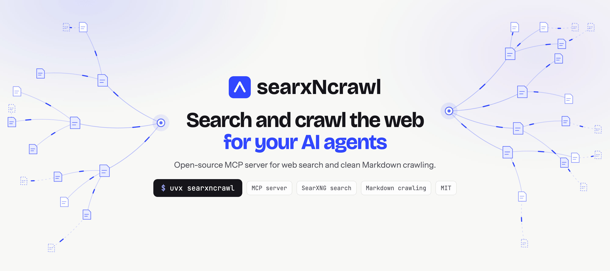

<p align="center">
  <a href="https://www.searxncrawl.io/">
    <picture>
      <source media="(prefers-color-scheme: dark)" srcset="docs/assets/banner-dark.png">
      
    </picture>
  </a>
</p>

<p align="center">
  <a href="https://pypi.org/project/searxncrawl/"></a>
  <a href="https://pypi.org/project/searxncrawl/"></a>
  <a href="https://github.com/DasDigitaleMomentum/searxNcrawl/actions/workflows/ci.yml"></a>
  <a href="LICENSE"></a>
  <a href="https://modelcontextprotocol.io/"></a>
</p>

<p align="center">
  <a href="https://www.searxncrawl.io/"><b>Website</b></a> ·
  <a href="#quick-start">Quick start</a> ·
  <a href="docs/overview.md">Docs</a> ·
  <a href="https://www.searxncrawl.io/developers/">Developers</a> ·
  <a href="https://www.searxncrawl.io/#cloud">Cloud (planned)</a> ·
  <a href="CHANGELOG.md">Changelog</a>
</p>

**searxNcrawl** is an open-source MCP server and CLI toolkit that gives AI agents web search and clean Markdown crawling, built on [Crawl4AI](https://github.com/unclecode/crawl4ai). Search queries the configured providers, [SearXNG](https://github.com/searxng/searxng) and/or [You.com](https://you.com), in parallel and merges the results. It runs on your own hardware, needs no API key with SearXNG and succeeds `searxng-mcp`.

<table>
  <tr>
    <td width="33%" valign="top"><b>Web search</b><br>Your own SearXNG instance and/or the You.com API, queried in parallel; results are merged and attributed to their providers, filtered by language and time range.</td>
    <td width="33%" valign="top"><b>Page crawl</b><br>One or many URLs to Markdown or JSON, with repeated blocks removed and links optionally stripped.</td>
    <td width="33%" valign="top"><b>Site crawl</b><br>Whole sites with depth and page limits, tuned for documentation.</td>
  </tr>
  <tr>
    <td valign="top"><b>Authenticated crawls</b><br>Capture a login session once with <code>crawl-capture</code>, then crawl behind the login.</td>
    <td valign="top"><b>STDIO and HTTP</b><br>Plug into local MCP clients, or expose an HTTP endpoint with host and CORS guards.</td>
    <td valign="top"><b>CLI and Python API</b><br><code>crawl</code>, <code>search</code> and <code>crawl-capture</code> on the command line, or import it in Python.</td>
  </tr>
</table>

```bash
SEARXNG_URL=http://your-searxng:8888 uvx searxncrawl
```

<!-- mcp-name: io.github.DasDigitaleMomentum/searxncrawl -->

## Quick Start

Pick your setup:

### Docker Compose

MCP server with Playwright/Chromium, ready in one command. Search needs at least one provider (a SearXNG instance and/or a You.com API key).

```bash
cp .env.example .env          # set SEARXNG_URL and/or YDC_API_KEY
docker compose up --build
```

➜ MCP server at `http://localhost:9555/mcp`

### uvx (no clone)

Run the MCP server from [PyPI](https://pypi.org/project/searxncrawl/), no clone or virtualenv. Chromium is downloaded automatically on the first crawl.

```bash
SEARXNG_URL=http://your-searxng:8888 uvx searxncrawl
```

The latest development version runs straight from GitHub with `uvx --from git+https://github.com/DasDigitaleMomentum/searxNcrawl searxncrawl`.

### pip (standalone)

CLI tools, Python API, and MCP server. Search needs SEARXNG_URL and/or YDC_API_KEY.

```bash
python -m venv .venv && source .venv/bin/activate
pip install -e .
playwright install chromium
```

### uv (standalone)

Same capabilities as pip.

```bash
uv sync
uv run playwright install chromium
```

### What you get

| Feature                 | Docker Compose | pip / uv  |
| ----------------------- | -------------- | --------- |
| MCP Server (STDIO)      | —              | ✅        |
| MCP Server (HTTP)       | ✅             | ✅        |
| Web Crawl               | ✅             | ✅        |
| Web Search              | ✅¹            | ✅¹       |
| CLI Tools               | via `exec`²    | ✅        |
| Python API              | —              | ✅        |
| CORS (HTTP)             | ✅             | ✅        |

¹ Requires at least one search provider (SearXNG instance and/or You.com API key). ² `docker compose exec searxncrawl crawl ...`

## Features

### Crawling
- Single page, multi-page, and **site crawling** (DFS with depth/page limits)
- Production-tested extraction config optimized for documentation sites
- Configurable timeouts with graceful error handling

### Content Quality
- **Markdown deduplication** — `exact` (default) removes repeated blocks, `off` disables it
- **Link removal** — strip all links for cleaner LLM context (`--remove-links`)
- **Dedup guardrails** — non-destructive metadata signals when removal is unusually aggressive

### Web Search
- Providers: SearXNG (self-hosted metasearch) and You.com (API key), each active only when configured
- All configured providers queried in parallel; results merged, deduplicated and attributed per provider
- Configurable language, time range, page; categories, engines and safe search for SearXNG

### MCP Server
- **STDIO transport** — for MCP harnesses (Zed, opencode, VS Code, Claude Code, etc.)
- **HTTP transport** — for remote access and browser clients
- **CORS support** — configurable origins for browser-based MCP clients
- Noise-free startup with UTF-8 encoding (cross-platform, incl. Windows)

### CLI Tools
- `crawl` — crawl pages from the command line
- `search` — search the web via the configured providers (SearXNG, You.com)
- `crawl-capture` — session capture for authenticated crawling

## Installation

### Docker Compose

The Compose stack includes searxNcrawl + Playwright/Chromium. Search providers (a SearXNG instance and/or a You.com API key) are configured separately.

```bash
cp .env.example .env
# Edit .env: set SEARXNG_URL and/or YDC_API_KEY
docker compose up --build
```

| Variable    | Default                   | Description                                                   |
| ----------- | ------------------------- | ------------------------------------------------------------- |
| `MCP_PORT`                  | `9555`                    | MCP server HTTP port                                          |
| `LOG_LEVEL`                 | `INFO`                    | MCP server log level (DEBUG, INFO, WARNING, ERROR, CRITICAL) |
| `PLAYWRIGHT_AUTO_INSTALL`   | `true`                    | Download Playwright's Chromium automatically before the first browser launch if it is missing. Set to `false` where browsers are provisioned separately |
| `FASTMCP_HTTP_ALLOWED_HOSTS` | (FastMCP secure defaults) | JSON list of trusted HTTP Host headers, for example `["mcp.example.com"]` |

The MCP server is available at `http://localhost:9555/mcp`.

### pip

```bash
cd searxNcrawl
python -m venv .venv
source .venv/bin/activate
pip install -e .
playwright install chromium
```

### uv

```bash
cd searxNcrawl
uv sync
uv run playwright install chromium
```

### Search providers

`search` (MCP tool and CLI command) queries every configured provider in parallel. A provider is active only when it is configured; with none configured, search returns an error naming `SEARXNG_URL` and `YDC_API_KEY`.

- **SearXNG** — active when `SEARXNG_URL` is a valid http(s) URL without embedded credentials. There is no default URL. The instance needs **JSON output enabled** (`search.formats` in `settings.yml`); self-hosting is recommended over public instances (rate limits). Basic auth credentials are optional: set both or neither.
- **You.com** — active when `YDC_API_KEY` is set (non-empty). Requests send the key in the `X-API-Key` header and the User-Agent `youdotcom-integration/dasdigitalemomentum-searxncrawl`. You.com queries go to You.com in the US.

**How results are combined:**

- `providers` (MCP, e.g. `["searxng"]`) or `--providers searxng,youcom` (CLI) narrows a call to a subset of the configured providers; unknown or unconfigured names return an error. Default: all configured providers.
- Results are merged round-robin with conservative URL dedup. Results returned by several providers come first, and every result lists its sources in `providers`. The list is capped at `max_results` (1–50).
- `language`, `time_range`, `safesearch` and `pageno` apply to both providers; `categories` and `engines` are SearXNG only. For You.com, `language` is mapped to its supported codes (e.g. `en-us` → `EN`; unsupported codes such as `zh` search without a language filter), and pages beyond 10 return no You.com results.
- If some providers fail, the results of the others are returned (the failure is logged as a warning). If all selected providers fail, search returns an error with a short reason per provider (no secrets, URLs or response bodies), e.g. `youcom: API key rejected, check YDC_API_KEY`.

**Environment variables:**

| Variable               | Example / Recommended                          | Description                                                                                                  |
| ---------------------- | ---------------------------------------------- | ------------------------------------------------------------------------------------------------------------ |
| `SEARXNG_URL`          | (none)                                         | SearXNG instance URL, e.g. `http://localhost:8888`; enables SearXNG                                          |
| `SEARXNG_USERNAME`     | (none)                                         | Optional basic auth user (set both or neither)                                                               |
| `SEARXNG_PASSWORD`     | (none)                                         | Optional basic auth pass (set both or neither)                                                               |
| `YDC_API_KEY`          | (none)                                         | You.com API key; enables You.com (queries go to You.com, US)                                                 |
| `SEARCH_RESULT_FIELDS` | `title,url,content,publishedDate,providers`    | Comma-separated result fields. Unset = all fields. Available: title, url, content, publishedDate, providers  |

Example `.env`:
```bash
SEARXNG_URL=http://localhost:8888
# YDC_API_KEY=your-you.com-api-key
SEARCH_RESULT_FIELDS=title,url,content,publishedDate,providers
LOG_LEVEL=INFO
```

**Config file search order** (CLI tools only):

1. `./.env` — current directory
2. `~/.config/searxncrawl/.env` — user config

If no `.env` exists, `.env.example` is auto-copied to the user config path.

## Usage

### MCP Server

#### Start the server

```bash
# STDIO transport (for MCP harnesses)
python -m crawler.mcp_server

# HTTP transport
python -m crawler.mcp_server --transport http --port 8000

# HTTP exposed through a specific public hostname
python -m crawler.mcp_server --transport http --host 0.0.0.0 --allowed-hosts "mcp.example.com"

# HTTP with CORS
python -m crawler.mcp_server --transport http --allowed-hosts "mcp.example.com" --cors-origins "https://app.example.com"

# Docker (HTTP only)
docker compose up --build
```

#### MCP client configuration

**With uvx (no clone, no venv):**

```json
{
  "mcpServers": {
    "crawler": {
      "command": "uvx",
      "args": ["searxncrawl"],
      "env": { "SEARXNG_URL": "http://your-searxng:8888" }
    }
  }
}
```

The first crawl downloads Playwright's Chromium once (about 550 MB on disk); later starts reuse it. On Linux hosts without the browser's system libraries, run `uvx --from searxncrawl playwright install --with-deps chromium` once.

**Python with venv:**

```json
{
  "mcpServers": {
    "crawler": {
      "command": "python",
      "args": ["-m", "crawler.mcp_server"],
      "cwd": "/path/to/searxNcrawl",
      "env": { "SEARXNG_URL": "http://your-searxng:8888" }
    }
  }
}
```

**With uv (no manual venv):**

```json
{
  "mcpServers": {
    "crawler": {
      "command": "uv",
      "args": ["run", "--directory", "/path/to/searxNcrawl", "python", "-m", "crawler.mcp_server"],
      "env": { "SEARXNG_URL": "http://your-searxng:8888" }
    }
  }
}
```

**Docker (HTTP endpoint):**

```json
{
  "mcpServers": {
    "crawler": {
      "url": "http://localhost:9555/mcp"
    }
  }
}
```

#### CORS

FastMCP validates the HTTP `Host` header independently of the address on which
the server listens. For remote access, allow the exact externally visible Host
header with a comma-separated CLI value:

```bash
crawl-mcp --transport http --host 0.0.0.0 --allowed-hosts "mcp.example.com,mcp.internal.example"
```

Alternatively, use FastMCP's environment setting. It uses JSON-list syntax:

```bash
FASTMCP_HTTP_ALLOWED_HOSTS='["mcp.example.com"]' crawl-mcp --transport http --host 0.0.0.0
```

Browser Origin validation and CORS response headers are separate from Host
validation. `--cors-origins` configures both FastMCP's Origin guard and the CORS
middleware using the same normalized, comma-separated values:

```bash
crawl-mcp --transport http --cors-origins "http://localhost:3000,https://myapp.com"
crawl-mcp --transport http --cors-origins "*"   # all origins — local dev only
```

Omitting either allowlist preserves FastMCP's secure defaults (and permits the
upstream environment setting to apply). A value of `*` for Hosts or Origins is
an explicit opt-in to broad access and should only be used when that security
trade-off is intentional. Without `--cors-origins`, no CORS headers are sent.

### CLI Tools

After `pip install -e .` (or `uv sync`), the following commands are available:

```bash
# Crawl a page
crawl https://docs.example.com

# Site crawl with depth limit
crawl https://docs.example.com --site --max-depth 2 --max-pages 10 -o docs/

# Clean output (no links)
crawl https://example.com --remove-links

# Search
search "python tutorials"
search "Rezepte" --language de --max-results 5
search "python tutorials" --providers searxng

# Session capture for authenticated crawling
crawl-capture --start-url https://example.com/login \
    --completion-url 'https://example.com/dashboard.*' \
    --output ./state.json
```

See [Session Capture](docs/usage/session-capture.md) for the full `crawl-capture` guide.

### Python API

```python
from crawler import crawl_page, crawl_page_async, crawl_site, crawl_site_async

# Single page
doc = await crawl_page_async("https://docs.example.com/intro", dedup_mode="exact")
print(doc.markdown)

# Site crawl
result = crawl_site("https://docs.example.com", max_depth=2, max_pages=10)
for doc in result.documents:
    print(f"{doc.status}: {doc.final_url}")

# Authenticated crawl
doc = await crawl_page_async(
    "https://example.com/private",
    auth={"storage_state": "/path/to/state.json"},
)
```

## Reference

- **[MCP Tools](docs/usage/mcp-tools.md)** — full parameter reference for `crawl`, `crawl_site`, `search`
- **[Output Formats](docs/usage/output-formats.md)** — Markdown and JSON output structure, including `CrawledDocument`
- **[Session Capture](docs/usage/session-capture.md)** — manual login flow and CDP session export

## Configuration

Default config is optimized for documentation sites. Customize via overrides:

```python
from crawler import build_markdown_run_config, RunConfigOverrides

config = build_markdown_run_config(
    RunConfigOverrides(
        delay_before_return_html=1.0,
        mean_delay=1.0,
        scan_full_page=True,
    )
)
doc = await crawl_page_async("https://example.com", config=config)
```

## Dependencies

- `crawl4ai>=0.7.4` — crawler engine
- `playwright>=1.40.0` — browser automation
- `fastmcp>=3.4.3` — MCP server framework
- `httpx>=0.27.0` — HTTP client for the search providers (SearXNG, You.com)
- `tldextract>=5.1.2` — domain parsing for site crawls

## License

MIT — © 2026 DDM – Das Digitale Momentum GmbH & Co KG

---

<p align="center">
  <sub>Maintained by <a href="https://www.das-digitale-momentum.de/en/open-source/#searxncrawl"><b>DDM – Das Digitale Momentum GmbH &amp; Co. KG</b></a>, Much, Germany · <a href="https://www.searxncrawl.io/">www.searxncrawl.io</a> · <a href="https://github.com/DasDigitaleMomentum">All our open-source projects</a></sub>
</p>
