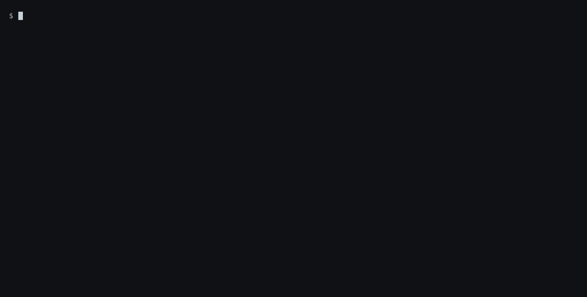
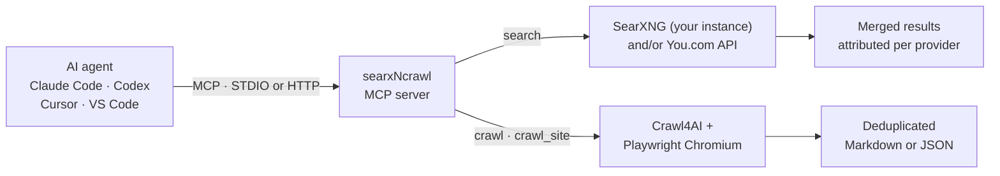

<p align="center">
  <a href="https://www.searxncrawl.io/">
    <picture>
      <source media="(prefers-color-scheme: dark)" srcset="docs/assets/banner-dark.png">
      
    </picture>
  </a>
</p>

<p align="center">
  <a href="https://pypi.org/project/searxncrawl/"></a>
  <a href="https://pypi.org/project/searxncrawl/"></a>
  <a href="https://github.com/DasDigitaleMomentum/searxNcrawl/actions/workflows/ci.yml"></a>
  <a href="LICENSE"></a>
  <a href="https://modelcontextprotocol.io/"></a>
</p>

<p align="center">
  <a href="https://www.searxncrawl.io/"><b>Website</b></a> ·
  <a href="#quick-start">Quick start</a> ·
  <a href="docs/overview.md">Docs</a> ·
  <a href="https://www.searxncrawl.io/developers/">Developers</a> ·
  <a href="https://www.searxncrawl.io/#cloud">Cloud (planned)</a> ·
  <a href="CHANGELOG.md">Changelog</a>
</p>

<p align="center">
  
  <br>
  <sub>A real MCP client session (fastmcp) against <code>uvx searxncrawl</code> 0.31.0 and a local SearXNG: <code>search</code>, then <code>crawl</code> the top hit into Markdown. Output is shortened for display. Reproduce it with <a href="docs/assets/demo/demo.tape"><code>docs/assets/demo/</code></a>.</sub>
</p>

**searxNcrawl** is an open-source MCP server and CLI toolkit that gives AI agents web search and clean Markdown crawling, built on [Crawl4AI](https://github.com/unclecode/crawl4ai). Search queries the configured providers, [SearXNG](https://github.com/searxng/searxng) and/or [You.com](https://you.com), in parallel and merges the results. It runs on your own hardware, needs no API key with SearXNG and succeeds `searxng-mcp`.

<table>
  <tr>
    <td width="33%" valign="top"><b>Web search</b><br>Your own SearXNG instance and/or the You.com API, queried in parallel; results are merged and attributed to their providers, filtered by language and time range.</td>
    <td width="33%" valign="top"><b>Page crawl</b><br>One or many URLs to Markdown or JSON, with repeated blocks removed and links optionally stripped.</td>
    <td width="33%" valign="top"><b>Site crawl</b><br>Whole sites with depth and page limits, tuned for documentation.</td>
  </tr>
  <tr>
    <td valign="top"><b>Authenticated crawls</b><br>Capture a login session once with <code>crawl-capture</code>, then crawl behind the login.</td>
    <td valign="top"><b>STDIO and HTTP</b><br>Plug into local MCP clients, or expose an HTTP endpoint with host and CORS guards.</td>
    <td valign="top"><b>CLI and Python API</b><br><code>crawl</code>, <code>search</code> and <code>crawl-capture</code> on the command line, or import it in Python.</td>
  </tr>
</table>

```bash
SEARXNG_URL=http://your-searxng:8888 uvx searxncrawl
```

<!-- mcp-name: io.github.DasDigitaleMomentum/searxncrawl -->

## Quick start

You need [uv](https://docs.astral.sh/uv/) and, for the `search` tool, at least one search provider: a SearXNG instance with JSON output enabled and/or a You.com API key (`YDC_API_KEY`). No SearXNG yet? [Start one with Docker](docs/usage/installation.md#run-searxng-locally). Crawling works without either.

### Add it to your agent

**One step for every agent on your machine**

```bash
uvx searxncrawl setup
```

`setup` detects Claude Code, Codex, Gemini CLI, Cursor, VS Code and Claude Desktop, asks for your SearXNG URL and, optionally, a You.com API key (hidden input, never printed), shows each config change and applies it only after you confirm. Every file it touches is backed up first, and `setup --remove` undoes it. More options are in [MCP server](docs/usage/mcp-server.md#register-with-searxncrawl-setup).

**Or per agent**

<p>
  <a href="https://cursor.com/en/install-mcp?name=searxncrawl&config=eyJjb21tYW5kIjoidXZ4IiwiYXJncyI6WyJzZWFyeG5jcmF3bCJdLCJlbnYiOnsiU0VBUlhOR19VUkwiOiJodHRwOi8vbG9jYWxob3N0Ojg4ODgifX0%3D"></a>
  <a href="https://insiders.vscode.dev/redirect/mcp/install?name=searxncrawl&config=%7B%22command%22%3A%22uvx%22%2C%22args%22%3A%5B%22searxncrawl%22%5D%2C%22env%22%3A%7B%22SEARXNG_URL%22%3A%22http%3A%2F%2Flocalhost%3A8888%22%7D%7D"></a>
</p>

The buttons and commands below assume SearXNG at `http://localhost:8888`; change `SEARXNG_URL` if yours runs elsewhere, or add `YDC_API_KEY` for You.com.

**Claude Code**

```bash
claude mcp add searxncrawl --env SEARXNG_URL=http://localhost:8888 -- uvx searxncrawl
```

**Codex**

```bash
codex mcp add searxncrawl --env SEARXNG_URL=http://localhost:8888 -- uvx searxncrawl
```

**VS Code**

```bash
code --add-mcp '{"name":"searxncrawl","command":"uvx","args":["searxncrawl"],"env":{"SEARXNG_URL":"http://localhost:8888"}}'
```

**Cursor (`~/.cursor/mcp.json`), Claude Desktop and other clients that use the `mcpServers` format**

```json
{
  "mcpServers": {
    "searxncrawl": {
      "command": "uvx",
      "args": ["searxncrawl"],
      "env": { "SEARXNG_URL": "http://localhost:8888" }
    }
  }
}
```

The first crawl downloads Playwright's Chromium once (about 550 MB). For Docker, HTTP transport and other setups see [Installation](docs/usage/installation.md) and [MCP server](docs/usage/mcp-server.md).

### Ask your agent

```text
Search for the Crawl4AI quick start, crawl the official page and summarise
how to run a first crawl.
```

Your agent calls `search`, picks a result and calls `crawl`. It gets back clean Markdown instead of raw HTML.

### Use the terminal

```bash
uvx --from searxncrawl crawl https://modelcontextprotocol.io/docs/getting-started/intro
SEARXNG_URL=http://localhost:8888 uvx --from searxncrawl search "model context protocol" --max-results 5
```

## How it works



Results return to the agent as the tool response. Search and crawling are also available as the `search` and `crawl` CLI commands, crawling also as a Python API.

searxNcrawl exposes three MCP tools:

| Tool | What it does |
| --- | --- |
| `search` | Queries the configured providers (SearXNG, You.com) in parallel and returns one merged, deduplicated list with the source of each result. Filters: language, time range, safe search, paging; categories and engines for SearXNG. |
| `crawl` | Renders one or many URLs in Chromium and returns Markdown or JSON with metadata and references. |
| `crawl_site` | Follows links from a seed URL within depth, page and timeout limits, tuned for documentation sites. |

Both crawl tools drop sections that repeat within a page's Markdown (`dedup_mode="exact"`), can strip links for a smaller context (`remove_links`), and accept a Playwright `storage_state` for pages behind a login. Full parameters are in the [MCP tools reference](docs/usage/mcp-tools.md).

## Why searxNcrawl

Hosted search and crawl APIs are quick to start with, but every call goes through someone else's service and is billed per request or credit. searxNcrawl runs on your own machine or server.

|  | searxNcrawl | [Firecrawl](https://github.com/firecrawl/firecrawl) | [Tavily](https://github.com/tavily-ai/tavily-mcp) | [Exa](https://github.com/exa-labs/exa-mcp-server) |
| --- | --- | --- | --- | --- |
| Search and crawl run on your hardware | ✅ Python package or Docker; You.com queries go to You.com | ✅ Self-host stack (Docker Compose), or hosted API | ❌ Hosted API | ❌ Hosted API |
| API key | Not needed with SearXNG; You.com needs one | Hosted API: needed. Self-hosted: not by default | Needed | Optional, anonymous use is rate-limited |
| Cost per call | None with SearXNG; You.com per its plans | Hosted: free monthly credits, then paid credits. Self-hosted: none | Free monthly credits, then paid credits | Free monthly credits, then paid per request |
| Search backend | Your SearXNG (the engines you enable) and/or You.com | Hosted: Firecrawl's search. Self-hosted: SearXNG if configured, otherwise DuckDuckGo | Tavily's search API | Exa's search index |
| Licence | MIT | AGPL-3.0 | MCP server MIT, API proprietary | MCP server MIT, API proprietary |

Self-hosted Firecrawl can search through SearXNG too; it runs as a multi-service stack (API, Playwright service, Redis, RabbitMQ, PostgreSQL and more), while searxNcrawl is a single Python process with Chromium, plus your SearXNG instance if you use one. A Firecrawl-compatible API for searxNcrawl is [planned](#roadmap).

Where the others are a better fit: if you do not want to run a search provider and a browser yourself, a hosted API is less work, and Exa's semantic search index or Firecrawl's extraction features go beyond what searxNcrawl does today. Comparison based on each project's public repository and documentation in October 2026; corrections are welcome. Firecrawl is a trademark of its owner; searxNcrawl is not affiliated with it.

## FAQ

<details>
<summary><b>Do I need SearXNG?</b></summary>

Only for the `search` tool, and only if you do not use You.com (`YDC_API_KEY`). `crawl` and `crawl_site` work without any search provider. SearXNG serves HTML only by default, so JSON output must be enabled (`search.formats` in `settings.yml`). Public instances may not enable it and often rate-limit automated requests, so run your own. [Installation](docs/usage/installation.md#run-searxng-locally) has a Docker one-liner.
</details>

<details>
<summary><b>Does it handle JavaScript-heavy pages?</b></summary>

Yes. Pages are rendered in Playwright's Chromium through Crawl4AI before they are converted to Markdown, so client-side content is captured.
</details>

<details>
<summary><b>Can it crawl pages behind a login?</b></summary>

Yes. Capture a session once with `crawl-capture`, then pass the saved `storage_state` file to `crawl` or `crawl_site`. See [Session capture](docs/usage/session-capture.md).
</details>

<details>
<summary><b>Can I run it remotely or share it with a team?</b></summary>

Yes. Start it with `--transport http` (port 8000 by default) or use the Docker Compose stack (port 9555), then point your MCP clients at `http://<host>:<port>/mcp`. Host and Origin allowlists guard the endpoint; see [MCP server](docs/usage/mcp-server.md#http-host-and-cors-guards).
</details>

<details>
<summary><b>Why is the first crawl slow?</b></summary>

The first crawl downloads Playwright's Chromium (about 550 MB on disk). Later runs reuse it. Set `PLAYWRIGHT_AUTO_INSTALL=false` where browsers are provisioned separately.
</details>

<details>
<summary><b>I used <code>searxng-mcp</code>. What changed?</b></summary>

[`searxng-mcp`](https://github.com/tisDDM/searxng-mcp) is deprecated in favour of searxNcrawl. It only searched SearXNG and could pick a random public instance; searxNcrawl adds page and site crawling but needs your own `SEARXNG_URL` (or a You.com key), as random public-instance selection is not included.
</details>

<details>
<summary><b>Is there a hosted version?</b></summary>

Not yet. searxNcrawl Cloud is planned; see the [roadmap](#roadmap).
</details>

## Roadmap

- **Firecrawl-compatible API** (planned): use searxNcrawl as a drop-in backend for tools built against the Firecrawl API.
- **searxNcrawl Cloud** (planned): a managed endpoint for teams that do not want to run SearXNG and a browser. [Details and waitlist](https://www.searxncrawl.io/#cloud).

Ideas and votes are welcome in [Discussions](https://github.com/DasDigitaleMomentum/searxNcrawl/discussions).

## Documentation

| Guide | Contents |
| --- | --- |
| [Installation](docs/usage/installation.md) | uvx, Docker Compose, pip, uv, search providers and environment variables |
| [MCP server](docs/usage/mcp-server.md) | STDIO and HTTP transports, client configuration, Host and CORS guards |
| [MCP tools](docs/usage/mcp-tools.md) | Parameters for `crawl`, `crawl_site` and `search` |
| [CLI](docs/usage/cli.md) | `crawl`, `search` and `crawl-capture` |
| [Python API](docs/usage/python-api.md) | `crawl_page`, `crawl_site` and crawler configuration overrides |
| [Output formats](docs/usage/output-formats.md) | Markdown and JSON structure, `CrawledDocument` |
| [Session capture](docs/usage/session-capture.md) | Authenticated crawling with a saved browser session |
| [MCP Registry](docs/registry.md) | `server.json` and the publish steps |
| [Architecture](docs/overview.md) | Modules and features for contributors |

## Contributing

Bug reports, feature ideas and pull requests are welcome. Read the [contributing guide](https://github.com/DasDigitaleMomentum/.github/blob/main/.github/CONTRIBUTING.md) and open an [issue](https://github.com/DasDigitaleMomentum/searxNcrawl/issues/new/choose) first for larger changes. Coding agents find project conventions in [AGENTS.md](AGENTS.md). Report vulnerabilities privately as described in the [security policy](https://github.com/DasDigitaleMomentum/.github/blob/main/.github/SECURITY.md).

## License

MIT — © 2026 DDM – Das Digitale Momentum GmbH & Co KG

---

<p align="center">
  <sub>Maintained by <a href="https://www.das-digitale-momentum.de/en/open-source/#searxncrawl"><b>DDM – Das Digitale Momentum GmbH &amp; Co. KG</b></a>, Much, Germany · <a href="https://www.searxncrawl.io/">www.searxncrawl.io</a> · <a href="https://github.com/DasDigitaleMomentum">All our open-source projects</a></sub>
</p>
